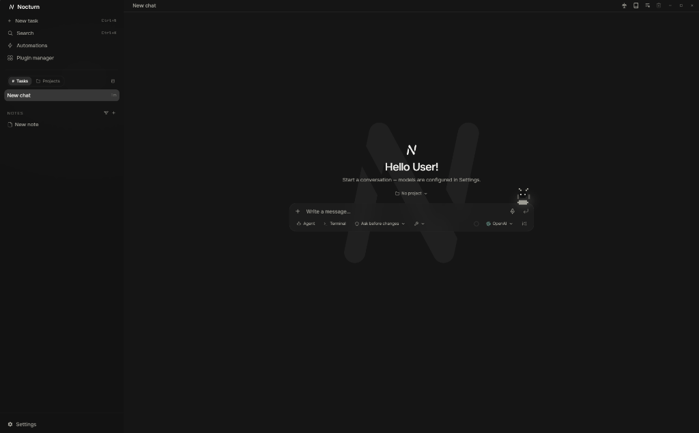
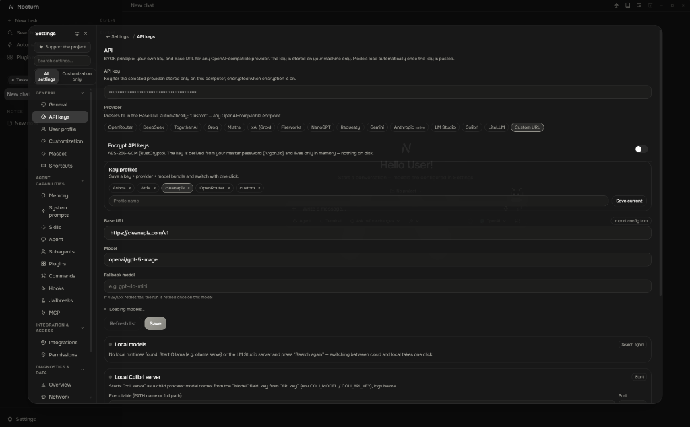
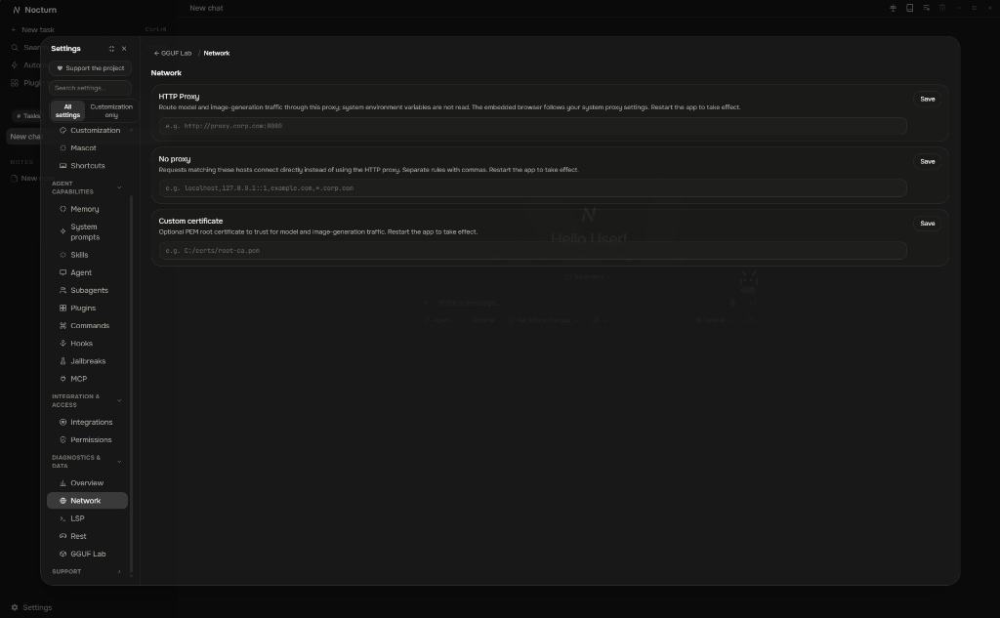
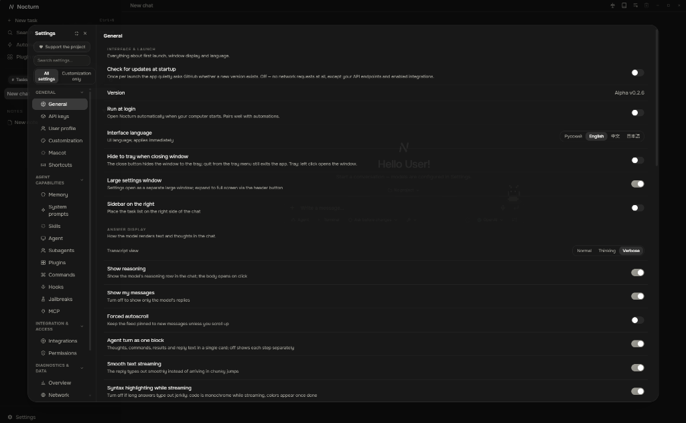
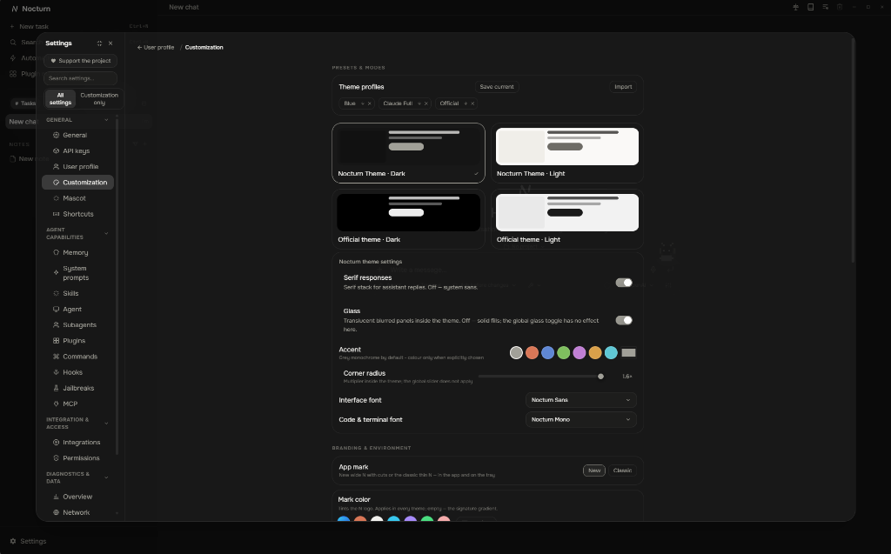

# Nocturn

<p align="center">
  
</p>

<p align="center">
  <strong>The private, local-first BYOK AI agent & client for desktop.</strong><br>
  Your machine. Your keys. Direct provider connection. Zero telemetry.
</p>

<p align="center">
  
  
  
  
  
  
  
</p>

---

## What is Nocturn?

**Nocturn** is a native, local-first **Bring Your Own Key (BYOK)** AI client and autonomous agent workstation for **Windows, Linux, and macOS**.

In an era where hosted web harnesses leak user keys, harvest prompts, and lock users into subscription tiers, Nocturn takes the opposite path:

* **Zero telemetry, zero intermediaries:** No accounts, no emails, no remote database. The client talks strictly and directly to the API endpoints you specify.
* **Encrypted local vault:** API keys can be secured with AES-256-GCM derived via Argon2id. Once locked, keys exist solely in transient memory.
* **Agent-grade capabilities on your terms:** Full PTY terminal, Browser Use (CDP), Computer Use, sandboxed WASM Python runner, multi-role subagents, checkpoints with instant rollback, and local FTS5 RAG.
* **Native speed & featherweight footprint:** Built on **Tauri 2 + Rust**. The installer is **~16.6 MB**, and idle RAM usage hovers around **~100 MB** (unlike 1+ GB Electron wrappers).

> [!NOTE]
> Multilingual interface out of the box: **English**, **Русский**, **中文**, and **日本語**.

---

## Key Pillars

### 1. Sovereign BYOK & Hardened Security

Connect any OpenAI-compatible endpoint, native Anthropic, Google Gemini, Ollama, LM Studio, or local gateways with zero setup friction.

<p align="center">
  
</p>

* **Encrypted Master Vault:** Guard API credentials behind an optional master password (Argon2id + AES-256-GCM). Auto-locks on idle.
* **Key Profiles:** Bundle keys, providers, and models into one-click profiles (`Production`, `Coding`, `Local-Ollama`, `Creative`).
* **Fallback Models:** Automatically retry on secondary models if provider 429/5xx errors strike.
* **Fail-Closed Server-Side Permissions:** Four security tiers (**Plan**, **Ask**, **Edit**, **Full**) enforced directly in Rust. Agents cannot bypass sensitive directories (`.env`, `.ssh`), traverse paths, or abuse chained shell execution without explicit user consent.

---

### 2. Autonomous Agent Workstation

Nocturn is not just a chat wrapper — it is a full agent environment capable of driving real development workflows safely.

* **Tools & Execution:** Native file system operations, interactive **PTY terminal** (xterm.js), headless **Browser Use** via Chrome DevTools Protocol (CDP) with a live view screen, and OS **Computer Use**.
* **Sandboxed Code Interpreter:** Python 3 execution runs inside a local Pyodide (WASM) worker with strictly isolated memory.
* **LSP Compile-Loop:** Agents receive immediate language server diagnostics after edits to self-correct compiler errors in the same turn.
* **Rollbacks & Checkpoints:** Automatic snapshotting before agent modifications. Review visual diffs on a visual timeline and roll back any file in one click.
* **Context Compaction:** Microcompacting old tool payloads and auto-summarizing conversation heads keeps long runs within context limits without losing track.
* **Subagents:** Orchestrate specialized worker agents (Researcher, Coder, Critic, Librarian) working in parallel.

---

### 3. Local Intelligence & Knowledge Bases (RAG)

Keep your knowledge entirely on your own hardware without uploading proprietary codebases or private documents to third-party embedding providers.

* **Local RAG on SQLite FTS5:** Index documentation, notes, and manuals. Semantic relevance retrieval is performed 100% locally on your CPU.
* **Personal Vault:** Markdown notes with bi-directional `[[wiki links]]` and interactive knowledge graph visualization.
* **GGUF Lab:** Inspect GGUF tensor layouts, perform surgical layer pruning, and test pruned local models directly inside your Ollama or llama-server runtime.

---

### 4. Enterprise-Grade Networking & Offline Controls

Nocturn gives you total authority over every packet that enters or leaves the application.

<p align="center">
  
</p>

* **Custom HTTP Proxy & Loopback Isolation:** Route model requests through corporate or local proxies while guaranteeing loopback traffic (Ollama/LM Studio/SearXNG) remains strictly on `127.0.0.1`.
* **Private Root Certificates:** Provide custom PEM root certificates for self-hosted LLM clusters or corporate SSL termination points.
* **SSRF & Redirect Defense:** Rust-level domain resolution, blocking loopback spoofing, and automatic token striping on cross-host redirects.

---

### 5. Highly Tunable UX & Answer Display

Tune every aspect of your reading and reasoning workflow to match your personal preference.

<p align="center">
  
</p>

* **Transcript View Modes:** Seamlessly switch between **Normal**, **Thinking** (deep reasoning inspection), and **Verbose** (full tool execution dumps).
* **Model Reasoning & Stream Smoothing:** Dedicated reasoning blocks, live syntax highlighting while streaming, and one-block agent turn collation.
* **System Tray & Quick Entry:** Hide to tray on minimize, launch on OS startup, and summon a floating prompt launcher anywhere via global shortcuts.

---

### 6. Tailored Themes & Nok the Mascot

Work should feel great. Nocturn comes with deep visual craftsmanship and a responsive desktop companion.

<p align="center">
  
</p>

* **Dual Aesthetics:** Choose between **Halo** (warm, organic palette inspired by Claude) and **Official** (stark monochrome in the Linear/Vercel ethos).
* **Glass & Typography:** Toggle real-time blurred glass panels, adjust corner radiuses, and choose between bundled clean typography (`Nocturn Sans` and `Nocturn Mono`).
* **Nok, the Firefly Mascot:** A tiny pixel companion living on your input bar. Nok watches your run: celebrates successes, panics on errors, streams during inference, naps when idle, and puts on headphones when system music plays.

---

### 7. Integrations & Power Tools

* **Model Context Protocol (MCP):** Connect external tools via **stdio** or **remote HTTP** with lazy reconnects, variable expansion, and encrypted OAuth tokens.
* **Automations & Idle Queue:** Schedule recurring prompts or let the engine process queued background tasks whenever system resources are idle.
* **Side-by-Side Model Comparison:** Run a single prompt against up to 3 models simultaneously to compare outputs, speed, and reasoning quality.
* **Offline Voice & Media Bar:** Local Whisper (`whisper.cpp`) push-to-talk dictation, offline wake-word ("Hey Jarvis"), Windows SAPI read-aloud, and native OS media controls (Spotify desktop & browser players).
* **Telegram Remote Control:** Securely authorize a private Telegram bot with a 6-digit one-time code to receive mobile notifications and approve tool requests from your phone.

---

## Performance & System Impact

| Metric | Nocturn (Tauri 2 + Rust) | Typical Electron AI Clients |
| :--- | :--- | :--- |
| **Installer Size** | **~16.6 MB** | ~120 – 250 MB |
| **Idle Memory (RAM)** | **~100 MB** (App + WebView2) | ~450 MB – 1.2 GB |
| **Startup Time** | **< 350 ms** | 2 – 5 seconds |
| **Telemetry / Tracking** | **0 bytes sent** | Continuous background pings |
| **Key Storage** | **Local encrypted vault** | Plaintext / Cloud databases |

---

## Getting Started

### Pre-built Binaries

Grab the latest installer for your operating system from [Releases](https://github.com/nocturn-dev/Nocturn/releases):

* **Windows:** `.msi` / `.exe` installer (automatic background updates).
* **Linux:** `.AppImage` (with in-app updates) or `.deb` / `.rpm` packages.
* **macOS:** `.dmg` (unsigned — right click → *Open* on initial launch).

### Building from Source

**Prerequisites:**
* [Node.js](https://nodejs.org/) (v20+)
* [Rust](https://rustup.rs/) (latest stable)
* Platform build tools (C++ build tools on Windows, `build-essential` on Linux)

```bash
# 1. Clone the repository
git clone https://github.com/nocturn-dev/Nocturn.git
cd Nocturn

# 2. Install frontend dependencies
npm install

# 3. Launch in development mode (launches native Tauri window)
npm run tauri dev

# 4. Build production installer
npm run tauri build
```

---

## Project Structure

```
├── src/                    # React 19 Frontend
│   ├── components/         # Chat cards, composer, settings modals, panels
│   ├── hooks/              # Agent run orchestration, voice, hotkeys
│   ├── locales/            # Strict ru / en / zh / ja localization tables
│   └── styles/             # Tailwind 4 theme tokens and appearance rules
├── src-tauri/              # Rust Native Backend
│   ├── src/
│   │   ├── chat.rs         # SSE streaming (OpenAI & Anthropic formats)
│   │   ├── tooling.rs      # Tool dispatcher & auto-exec analysis
│   │   ├── perm.rs         # Server-side permission gates (Plan/Ask/Edit/Full)
│   │   ├── crypto.rs       # AES-256-GCM + Argon2id master vault
│   │   ├── mcp.rs          # Model Context Protocol engine (stdio / HTTP)
│   │   ├── browser.rs      # Chrome DevTools Protocol (CDP) controller
│   │   ├── pty.rs          # ConPTY / Unix pseudo-terminals
│   │   ├── kb.rs           # Local SQLite FTS5 RAG indexing
│   │   └── gguf.rs         # GGUF inspection & tensor surgery
└── docs/screenshots/       # Application captures and documentation assets
```

---

## Verification & Code Quality

Nocturn enforces strict safety rituals:

```bash
# Fast verification (TypeScript + ESLint + Vitest)
node scripts/verify.mjs fast

# Full audit suite (Fast suite + Cargo Clippy -D warnings + Rust tests + Build)
node scripts/verify.mjs all
```

---

## License

Distributed under the [MIT License](LICENSE). Built for privacy, speed, and sovereign local AI.
